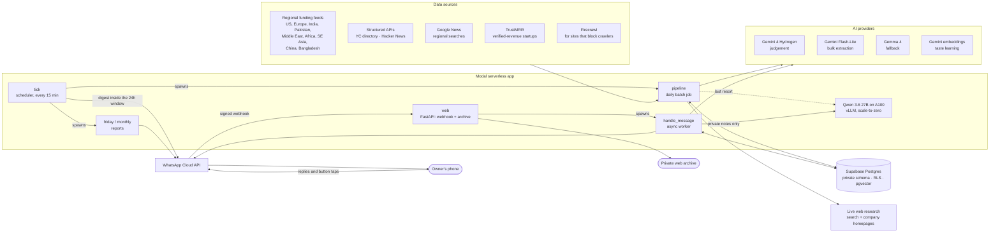
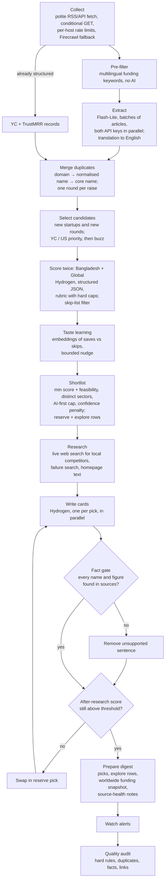
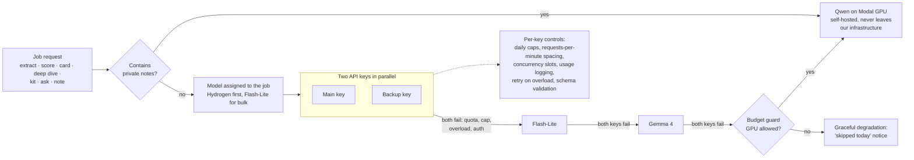
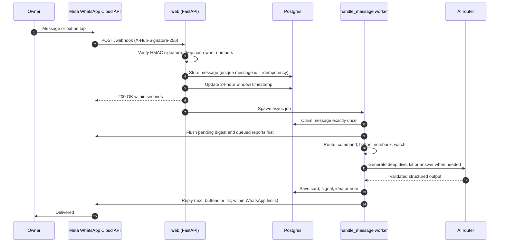

# Startup Scout

**Turn the world's startup funding news into ready-to-test business ideas for Bangladesh — delivered to WhatsApp
every morning.**

Every funding round is a signal: an investor has just validated that a problem is real and worth paying to solve.
Startup Scout captures those signals from around the world, filters out what a small team can't build, and
translates the rest into concrete opportunities — for the Bangladeshi market and for selling globally from
Bangladesh.

---

## Why it matters

The best early-stage opportunities are often proven elsewhere first. The information exists, but it is scattered
across many publications, countries and languages, and none of it is framed for local realities such as mobile
wallet payments, Bangla-first users and Facebook-driven commerce.

Startup Scout does that research and adaptation automatically, so you start each day with a short, curated list of
ideas instead of an endless news feed.

---

## Key features

### Daily intelligence briefing
A morning WhatsApp digest with the strongest opportunities for Bangladesh, the strongest opportunities to build in
Bangladesh and sell abroad, additional ideas from other industries, and a snapshot of what was funded worldwide
overnight.

### Opportunity cards
Each pick opens a concise brief:
- What the company does and why investors backed it, with sources
- How a small local team could build a Bangladeshi version (payments, language, devices, licences)
- How the same idea could be sold internationally from Bangladesh
- Where AI can make it cheaper or better
- Who already operates in Bangladesh, found through live web research
- A practical plan to test demand within a week
- A transparent explanation of every score

### Dual-market scoring
Every startup is evaluated twice — for the local market and for global sales from Bangladesh — against clear
criteria: customer pain, timing, feasibility for a small team, cost to start and fit with your skills. Ideas that
require heavy capital, hardware, special licences or physical operations are flagged and filtered out early.

### Global coverage, balanced results
Coverage spans Y Combinator and the US, Europe, India, Pakistan, the Middle East, Africa, Southeast Asia, China and
Bangladesh, with non-English sources translated automatically. Daily picks are drawn from different industries so the
list reflects the whole market, not a single trend.

### Verified facts only
Every factual statement must come from a source the system has actually read. An automated fact check removes any
name or figure it cannot verify, and anything unknown is labelled as unknown.

### On-demand deep dives
One tap produces a full analysis: local competitors, comparable startups that failed and why, revenue model and
pricing in taka, key risks and a first-week action plan.

### Idea notebook and validation kits
Save promising ideas and track them from exploration to testing to decision. Generate a customer interview script in
Bangla with English translations, landing-page copy, price points to test and a launch plan.

### Private field notes
Record what customers tell you. Notes are processed only by a self-hosted open-source model and never sent to
third-party AI providers. The system tracks which of your assumptions are holding and which are at risk.

### Focused Q&A
Ask questions about any card or saved idea and get direct answers grounded in that material.

### Watchlists and alerts
Follow a sector, stage, country or specific company and receive an alert only when something new happens.

### Personalised ranking
Your saves and skips refine future recommendations over time, within limits that keep the results broad.

### Weekly and monthly reports
A weekly review of new Y Combinator companies and the most relevant ones, and a monthly view of what is being
funded in markets similar to Bangladesh.

### Private web archive
A secure, searchable archive of every card with filters for market, country, sector and score, plus a board view of
your notebook.

### Built for reliability
Multiple AI models back each other up, including a self-hosted fallback, so the daily briefing continues even when a
provider is unavailable. Built-in budget controls keep the system on free tiers.

---

## Architecture

### System overview



### Daily pipeline



### AI routing and fallback



### WhatsApp message lifecycle



**Technology:** Google Gemini for analysis, with Gemma and a self-hosted Qwen model as fallbacks; a serverless
application on Modal; PostgreSQL on Supabase with row-level security and pgvector; the WhatsApp Cloud API.

**Safeguards:** messages go only to the owner, webhooks are signature-verified and idempotent, WhatsApp's 24-hour
messaging window is enforced with a pending queue, private notes stay on self-hosted infrastructure, a budget guard
caps spending, and a daily quality audit checks scoring rules, duplicates, facts and links.

---

## Getting started

Requirements: free accounts with Google AI Studio, Meta for Developers (WhatsApp Cloud API), Supabase and Modal.

```bash
git clone https://github.com/ShahidAhmed7/startup-scout.git && cd startup-scout
uv venv --python 3.12 .venv && uv pip install --python .venv/bin/python -r requirements.txt
cp .env.example .env                      # add your credentials
.venv/bin/python -m scout.db.migrate
.venv/bin/modal secret create scout-secrets --from-dotenv .env
.venv/bin/modal deploy app.py
.venv/bin/python -m scout.status          # verify the setup
```

Preview a full run without sending any messages:

```bash
.venv/bin/python -m scout.run --dry --dev
```

Customise the target market, skills, excluded industries and scoring weights in `config.yaml`, and the news sources
in `sources.yaml`.
